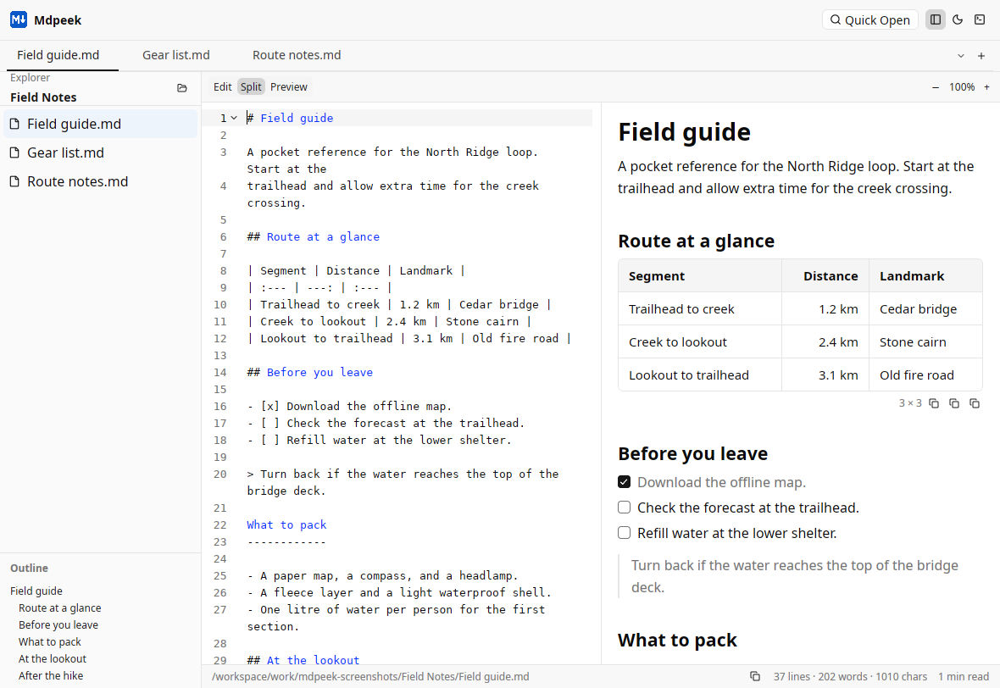
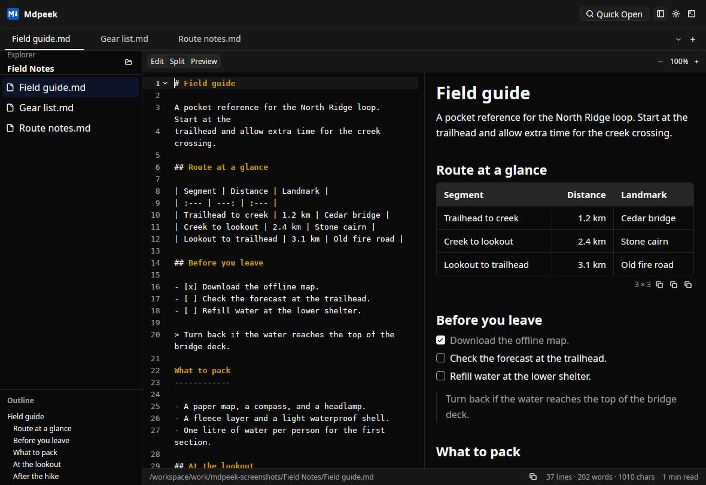

<div align="center">


# mdpeek

**A quiet, fast native Markdown reader and editor.**

Mdpeek is being rebuilt as a pure Rust desktop application using GPUI. The former Tauri/JavaScript implementation has been removed from the main application path; the native crate is now the product.

[](LICENSE)
[](https://github.com/sanketpatel32/Mdpeek/releases/latest)

</div>

## What’s new in v3.2.0

- A refreshed light and dark workspace with a compact header, clearer tabs, a file explorer and outline, and a welcome screen.
- Direct **Edit**, **Split**, and **Preview** controls. Split stacks vertically in narrow windows.
- Recent files appear on the welcome screen and in **Quick Open** across restarts.
- Use **Copy file path** from the command palette. Markdown reading time appears in the document status bar.

[Download v3.2.0 for Windows, Linux, or macOS](https://github.com/sanketpatel32/Mdpeek/releases/tag/v3.2.0).

## Current native feature set

- Multi-tab Markdown, text, code, CSV/TSV, and image documents
- Split, editor-only, and preview-only modes for text documents, plus image preview
- Markdown rendering with GFM tables, task lists, frontmatter, MDX parsing, alert/callout surfaces, and local images
- Source editing with line numbers, indentation guides, folding, syntax highlighting, editor search/replace, and Markdown autocomplete
- Clickable preview task checkboxes that update the Markdown source
- Inline and block math fallback rendering with Unicode/script compaction
- Wiki links (`[[Page]]`) and relative Markdown links open as documents
- File explorer, heading outline, quick open (`Ctrl+P`), workspace content search (`Ctrl+Shift+F`), project-wide replace (`Ctrl+Shift+R`), daily notes (`Ctrl+Shift+D`), reopen closed tab, and reading mode (`F11`)
- Session restoration for open documents, workspace, sidebar, theme, and active tab
- Automatic reload for externally changed clean files
- HTML, plain-text, and simple PDF export
- Visual table editing at the cursor (`Ctrl+Alt+M`), plus copying tables as Markdown, CSV, or TSV; copy fenced code blocks
- Markdown snippet picker (`Ctrl+Shift+S`) for common blocks and structures
- Zoom controls for previews and image documents
- Document link checking (`Ctrl+Alt+I`)
- Light and dark themes

## Screenshots

| Light theme | Dark theme |
| --- | --- |
| [](.github/assets/workspace-light-split.jpg) | [](.github/assets/workspace-dark-split.jpg) |

[Welcome screen](.github/assets/workspace-light-welcome.jpg) · [Stacked Split in a narrow window](.github/assets/workspace-narrow-split.jpg)

## Build and run

Use stable Rust with `rustfmt` and `clippy`. On Debian or Ubuntu, install the same system libraries as CI.

```bash
rustup component add rustfmt clippy
sudo apt-get update
sudo apt-get install -y libxkbcommon-x11-dev libwayland-dev libxkbcommon-dev libfontconfig-dev
```

```bash
cargo run -p mdpeek
```

Run checks:

```bash
cargo fmt --check
cargo clippy --locked -p mdpeek -- -D warnings
cargo test --locked -p mdpeek
cargo build --locked --release -p mdpeek
```

Open files or folders directly:

```bash
cargo run -p mdpeek -- README.md path/to/workspace
```

## Keyboard shortcuts

| Action | Shortcut |
| --- | --- |
| New document | `Ctrl+N` |
| Open file | `Ctrl+O` |
| Quick open | `Ctrl+P` |
| Command palette | `Ctrl+Alt+P` |
| Workspace search | `Ctrl+Shift+F` |
| Workspace replace | `Ctrl+Shift+R` |
| Insert snippet | `Ctrl+Shift+S` |
| Edit table at cursor | `Ctrl+Alt+M` |
| Daily note | `Ctrl+Shift+D` |
| Check links | `Ctrl+Alt+I` |
| Open folder | `Ctrl+Shift+E` |
| Save | `Ctrl+S` |
| Save as | `Ctrl+Alt+S` |
| Close tab | `Ctrl+W` |
| Reopen closed tab | `Ctrl+Alt+T` |
| Edit/preview | `Ctrl+E` |
| Sidebar | `Ctrl+B` |
| Reading mode | `F11` |
| Reload | `Ctrl+R` |
| Theme | `Ctrl+Shift+L` |
| Export HTML/text/PDF | `Ctrl+Shift+H` / `Ctrl+Shift+T` / `Ctrl+Shift+P` |
| Next/previous tab | `Ctrl+Tab` / `Ctrl+Shift+Tab` |
| Quit | `Ctrl+Q` or `Alt+F4` |

## Rebuild status

This is an alpha native rebuild. Core document workflows are implemented in Rust/GPUI, but the legacy application had a much larger feature surface. Not yet ported: Mermaid diagrams, full KaTeX-typeset math, rich system print preview, image annotation, and automatic updates in the native application. Visual table editing currently supports cell editing plus row/column insertion; richer row/column movement, deletion, and alignment controls are still pending.

## Contributing

See [CONTRIBUTING.md](CONTRIBUTING.md). Commit small, focused changes using conventional commit messages.
