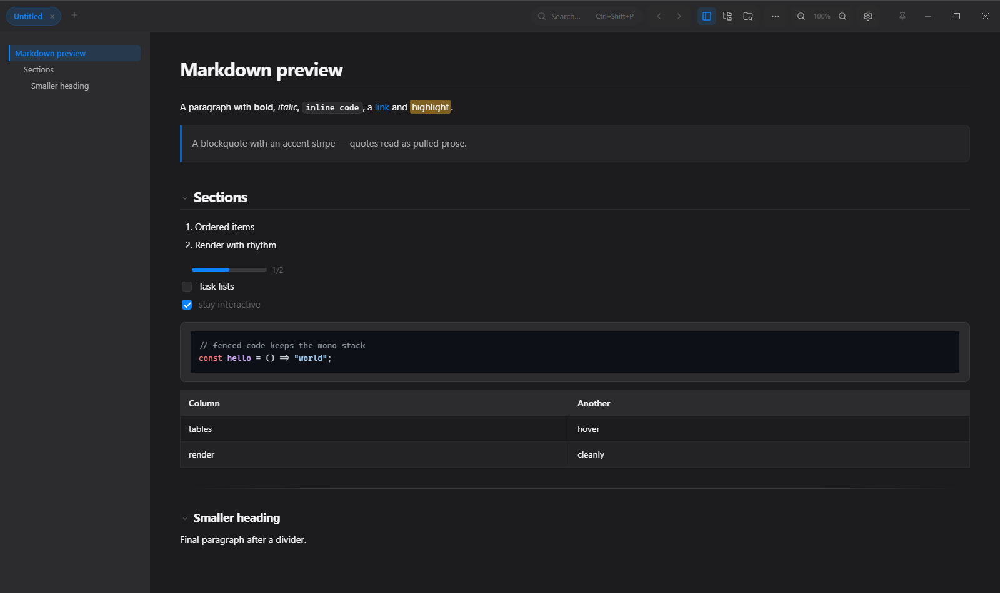

<div align="center">


# mdpeek

**A featherlight Markdown viewer/editor for Windows.**

Open, read, and edit `.md` / `.txt` files instantly — with live preview, tabs, a file explorer, and clean exports. No IDE chrome, no ceremony. Roughly a 7 MB installer.

[](https://tauri.app)
[](LICENSE)
[](https://github.com/sanketpatel32/Mdpeek/releases/latest)
[](https://github.com/sanketpatel32/Mdpeek/releases/latest)
[](CHANGELOG.md)
[](https://github.com/sanketpatel32/Mdpeek/releases/latest)

Built with **Tauri 2 + vanilla JS**. Uses the system WebView2 (no bundled
Chromium), making it far smaller than Electron-based viewers like MarkText
(~90 MB) or mdview (~70 MB).

[Features](#-features) · [Install](#-install) · [Shortcuts](#-keyboard-shortcuts) · [Build](#-build) · [Contributing](#-contributing) · [Changelog](CHANGELOG.md)



</div>

---

## ✨ Features

### 📝 Markdown rendering & editing

- **GitHub-flavored Markdown** — headings, tables, task lists, strikethrough, footnotes
- **Syntax highlighting & code actions** — 190+ languages (highlight.js) with "Copy code" and "Save code block as file" actions
- **Snippet & template picker (`Ctrl+Shift+S`)** — insert callouts, tables, task lists, code blocks, KaTeX math
- **Visual table editor** — edit the GFM table under the caret in a grid modal instead of fighting pipes
- **Inline autocomplete** — an as-you-type dropdown in the editor
- **Smart paste** — pasted content adapts to the surrounding Markdown context
- **Math** via KaTeX — `$inline$` and `$$block$$`
- **Mermaid diagrams** — flowcharts, sequence diagrams, gantt charts (lazy-loaded)
- **Alert callouts** — GitHub-style `> [!NOTE]` / `[!TIP]` / `[!WARNING]` / `[!CAUTION]` / `[!IMPORTANT]`
- **Heading IDs + table of contents** — in-document anchors and a collapsible TOC sidebar
- **Emoji shortcodes** — `:smile:`, `:thumbsup:`, `:tada:` and ~175 more
- **Clickable task checkboxes** — check a `- [ ]` box in the rendered view and the source updates
- **Live syntax highlighting in editor** — transparent-text overlay preserving native cursor, selection, IME, and spellcheck
- **Smart editing** — Tab/Shift+Tab indent, list continuation on `Enter`, auto-pair brackets/quotes, auto-close code fences
- **Editor line operations** — `Ctrl+D` duplicate, `Alt+↑`/`Alt+↓` move, `Ctrl+/` toggle comment
- **Region folding** — collapse a heading's section from the editor gutter
- **Go to line (`Ctrl+G`)**, **typewriter mode (`Ctrl+Shift+T`)**, word-wrap, line numbers
- **Unified find & replace** — `Ctrl+F` to find, `Ctrl+H` to replace, in view and edit modes

### 🧠 Notes & files

- **`[[wiki-links]]`** — Obsidian-style `[[Target]]` and `[[Target|Display]]` links resolve to files in your folder
- **Link checker** — extract every link in a document and flag broken ones
- **Daily notes** — one keystroke to today's journal file
- **Tabs** — pin, reorder, bulk-close, reopen closed tabs (`Ctrl+Alt+T`)
- **Built-in file explorer** — open a folder, browse the tree (`Ctrl+Shift+E`), right-click for Cut / Copy / Rename / Delete
- **Project-wide find & replace** — search a folder and replace across matches with live preview
- **Back / Forward** navigation (`Alt+←` / `Alt+→`) and quick switcher (`Ctrl+P`)

### 📁 Beyond Markdown

- **Code & config files** — `.js`, `.ts`, `.py`, `.json`, `.css`, `.yml`, `Dockerfile`, and 60+ more open as syntax-highlighted views **and can be edited** (`Ctrl+E`)
- **Plain text** — `.txt` files open in a full-width Notepad-style editor
- **CSV / TSV viewer** — delimited files as a sortable table
- **Image viewer** — `.png`, `.jpg`, `.gif`, `.webp`, `.svg`, `.bmp`, `.ico`, `.avif` with zoom + fit-to-window; **annotate** images with the freehand drawing toolbar

### 📖 Reading mode

- A distraction-free reader — width, font, and theme controls
- **Scroll progress bar** and **scroll position memory**

### 📤 Export

- **Export HTML** — standalone themed document, print-ready
- **Export PDF** — via the system print pipeline
- **Copy as HTML / plain text / rich text**, **open in browser**

### 🪟 Window & UI

- **Calm glass UI** — frosted topbar, motion system, lucide icons, content-first layout
- **5 themes** — Light, Dark, OLED Black, Solarized Light, Nord
- **Always-on-top**, system tray, single-instance, auto-updates, Windows context-menu integration

---

## 📥 Install

### Option 1 — Terminal (one-liner)

Open **PowerShell** and paste:

```powershell
irm https://raw.githubusercontent.com/sanketpatel32/Mdpeek/main/install.ps1 | iex
```

Fetches the latest release, downloads the installer, and runs setup. Installs to `C:\Program Files\mdpeek\` with a Start Menu shortcut.

### Option 2 — Manual download

Download from the [Releases page](https://github.com/sanketpatel32/Mdpeek/releases/latest):

| File | Description |
| --- | --- |
| `mdpeek-*-setup.exe` | NSIS installer (recommended) |
| `mdpeek-*-portable.exe` | Standalone — no install, just run |

> Requires **Windows 10 or 11**. WebView2 ships with the OS.

---

## ⌨️ Keyboard shortcuts

> The full list is also available in-app via `Ctrl+Shift+P` and under **Settings → Shortcuts**.

| Action | Key |
| --- | --- |
| Command palette | `Ctrl+Shift+P` |
| Quick switcher (recent files) | `Ctrl+P` |
| Snippet / template picker | `Ctrl+Shift+S` |
| Open file / folder | `Ctrl+O` / `Ctrl+Shift+E` |
| New tab / Close tab | `Ctrl+N` / `Ctrl+W` |
| Save / Save as | `Ctrl+S` / `Ctrl+Alt+S` |
| Toggle edit / view | `Ctrl+E` |
| Toggle sidebar (TOC) | `Ctrl+B` |
| Find / Find & Replace | `Ctrl+F` / `Ctrl+H` |
| Find next / previous | `F3` / `Shift+F3` |
| Search in folder | `Ctrl+Shift+F` |
| Go to line | `Ctrl+G` |
| Back / Forward | `Alt+←` / `Alt+→` |
| Reopen closed tab | `Ctrl+Alt+T` |
| Zoom in / out / reset | `Ctrl+=` / `Ctrl+-` / `Ctrl+0` |
| Focus / Zen mode | `F11` |
| Typewriter mode | `Ctrl+Shift+T` |
| Reading mode | `Ctrl+Shift+R` |
| Always-on-top | `Ctrl+Shift+A` |

Editor: **Bold** `Ctrl+B` · **Italic** `Ctrl+I` · **Strikethrough** `Ctrl+Shift+X` · **Link** `Ctrl+K` · **Duplicate line** `Ctrl+D` · **Move line** `Alt+↑/↓` · **Comment** `Ctrl+/`

---

## 🔧 Build

**Prerequisites:** [Node.js](https://nodejs.org/) 18+, [Rust](https://rustup.rs/) stable, Windows 10/11.

```bash
git clone https://github.com/sanketpatel32/Mdpeek.git
cd Mdpeek
npm install            # install dependencies
npm test               # run unit tests (Vitest)
npm run tauri dev      # launch in dev mode (hot reload)
npm run tauri:build    # build production installer -> releases/
npm run make-release   # sign + publish to GitHub Releases (maintainers)
```

---

## 📁 Project layout

```
src/
├── lib/            Pure feature modules — renderer.js (MD → HTML pipeline),
│                   editor-logic.js, documents.js (doc model + store),
│                   link-checker.js, templates.js, and friends. DOM-free, tested.
├── views/          UI screens — editor, viewer, image/csv/code viewers,
│                   file-tree, find-bar, command-palette, folder-search, …
├── main.js         App wiring: tabs, shortcuts, IPC, settings, file watcher
└── styles/         tokens.css, themes.css (5 themes), base.css, content.css,
                    reader.css, motion.css, workspace.css

src-tauri/src/      Rust backend — lib.rs (tray, updater, single-instance),
                    commands.rs (open/save/search/file-ops), watcher.rs
test/               Vitest specs (jsdom) covering the app end-to-end
```

---

## 🤝 Contributing

Issues labeled [`good first issue`](https://github.com/sanketpatel32/Mdpeek/labels/good%20first%20issue), [`beginner friendly`](https://github.com/sanketpatel32/Mdpeek/labels/beginner%20friendly), or [`help wanted`](https://github.com/sanketpatel32/Mdpeek/labels/help%20wanted) are ready for anyone to pick up.

- 💬 **No need to ask to be assigned — just start working on it and open a PR.**
- 📋 See [CONTRIBUTING.md](CONTRIBUTING.md) for setup, and the [PR template](.github/PULL_REQUEST_TEMPLATE.md) for the expected pull-request format.

> ⭐ If mdpeek makes you more productive, **[starring the repo](https://github.com/sanketpatel32/Mdpeek)** helps others find it.

---

## 📜 License

[MIT](LICENSE) © Sanket Patel
